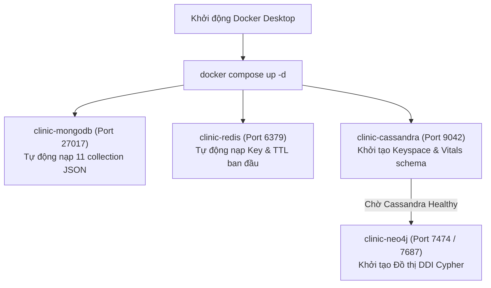

# SMART CLINIC EMR – HỆ THỐNG QUẢN LÝ PHÒNG KHÁM THÔNG MINH

> **Hệ thống Quản lý Phòng khám Đa khoa & Bệnh án Điện tử (EMR)**  
> Ứng dụng kiến trúc **Polyglot Persistence NoSQL** (MongoDB, Redis, Cassandra, Neo4j) kết hợp giao diện y tế cao cấp với **Angular** và tầng dịch vụ **Spring Boot**.

---

## 📑 MỤC LỤC
1. [Tổng Quan Kiến Trúc & Hiện Trạng Dự Án](#1-tổng-quan-kiến-trúc--hiện-trạng-dự-án)
2. [Yêu Cầu Môi Trường Cài Đặt](#2-yêu-cầu-môi-trường-cài-đặt)
3. [Hướng Dẫn Khởi Chạy Cụm 4 CSDL NoSQL (Docker Compose)](#3-hướng-dẫn-khởi-chạy-cụm-4-csdl-nosql-docker-compose)
4. [Hướng Dẫn Khởi Chạy Backend (Spring Boot)](#4-hướng-dẫn-khởi-chạy-backend-spring-boot)
5. [Hướng Dẫn Khởi Chạy Frontend (Angular)](#5-hướng-dẫn-khởi-chạy-frontend-angular)
6. [Tài Khoản Thử Nghiệm & Các Phân Hệ (Demo Roles)](#6-tài-khoản-thử-nghiệm--các-phân-hệ-demo-roles)
7. [Kiểm Tra & Truy Vấn Trực Tiếp 4 CSDL NoSQL](#7-kiểm-tra--truy-vấn-trực-tiếp-4-csdl-nosql)
8. [Danh Mục 24 Use Cases & Hệ Thống API RESTful](#8-danh-mục-24-use-cases--hệ-thống-api-restful)
9. [Cấu Trúc Thư Mục Dự Án](#9-cấu-trúc-thư-mục-dự-án)
10. [Xử Lý Lỗi Thường Gặp (Troubleshooting)](#10-xử-lý-lỗi-thường-gặp-troubleshooting)

---

## 1. TỔNG QUAN KIẾN TRÚC & HIỆN TRẠNG DỰ ÁN

Dự án gồm các thành phần hoàn chỉnh phối hợp chặt chẽ:

- **Frontend (`/frontend`)**: Xây dựng bằng **Angular (v22+)**, giao diện **NG-ZORRO (Ant Design)** chuẩn Luxury Healthcare Palette (Deep Teal, Champagne Gold, Sage, Burgundy, Ink Slate, Ivory). Quản lý phản ứng với **Signals**, hỗ trợ đầy đủ 4 phân hệ vai trò, màn hình sảnh TV xếp hàng tự động, xuất tệp Excel (.xlsx) sổ thu ngân nguyên bản và trang chi tiết dịch vụ.
  - *Tình trạng*: **100% Build thành công** với hơn 25 Lazy Chunks tối ưu hóa tải trang.
- **Backend (`/backend`)**: Xây dựng bằng **Java Spring Boot (Java 17 LTS)**, bảo mật Spring Security (Stateless, CORS enabled), kiến trúc phân lớp sạch (Clean Layered Architecture), kiểm soát nghiêm ngặt 28 Business Rules (BR-01 đến BR-28).
  - *Tình trạng*: **Hoàn thành 14 Controllers, 14 Services**, bộ kiểm thử tự động đạt **141/141 Tests PASS (100%)**.
- **Cơ sở dữ liệu đa mô hình NoSQL (`/database`)**: Thiết kế theo triết lý **Polyglot Persistence**:
  - **MongoDB v7.0**: Bệnh án EMR bán cấu trúc, Hồ sơ bệnh nhân, Danh mục dược, Hóa đơn viện phí.
  - **Redis v7.4**: Khóa giữ chỗ slot lịch hẹn (TTL = 10 phút), Hàng đợi thời gian thực FIFO, Bộ đếm STT nguyên tử, Blacklist JWT token.
  - **Apache Cassandra v4.1**: Dữ liệu chuỗi thời gian 5 chỉ số sinh tồn (`patient_vital_signs`) & Nhật ký kiểm toán bất biến (`medical_audit_logs`, Append-Only).
  - **Neo4j v5.26**: Mạng lưới tri thức thuốc và phát hiện cảnh báo tương tác thuốc đối kháng (DDI) & Chống chỉ định ICD-10.

---

## 2. YÊU CẦU MÔI TRƯỜNG CÀI ĐẶT

Trước khi chạy dự án, hãy đảm bảo máy tính đã cài đặt các công cụ sau:

| Thành phần | Yêu cầu phiên bản | Kiểm tra bằng lệnh | Ghi chú |
|---|---|---|---|
| **Docker Desktop** | Bản mới nhất (v25+ / v28+) | `docker --version`<br>`docker compose version` | Bắt buộc bật Docker Desktop trước khi khởi động cụm CSDL |
| **Java JDK** | Java 17 LTS (khuyến nghị JDK 17) | `java -version` | Đường dẫn ví dụ: `C:\Program Files\Java\jdk-17` |
| **Node.js** | v18.x, v20.x hoặc v22.x+ | `node -v` | Khuyến nghị bản LTS |
| **npm** | v9.x, v10.x hoặc v11.x | `npm -v` | Đi kèm với Node.js |
| **Git** | Bản mới nhất | `git --version` | Quản lý mã nguồn |

---

## 3. HƯỚNG DẪN KHỞI CHẠY CỤM 4 CSDL NOSQL (DOCKER COMPOSE)

Toàn bộ cụm 4 cơ sở dữ liệu NoSQL được định nghĩa trong file `docker-compose.yml` ở thư mục gốc của dự án.



### Bước 1: Khởi động ứng dụng Docker Desktop
- Mở menu Start của Windows, khởi chạy **Docker Desktop**.
- Chờ đến khi biểu tượng Docker ở thanh Taskbar hiển thị trạng thái màu xanh (**Docker Engine running**).

### Bước 2: Khởi động cụm 4 Database
Mở Terminal (PowerShell) tại thư mục gốc của dự án (`clinic-management`) và chạy:

```powershell
docker compose up -d
```

Docker sẽ tự động tải các image và khởi tạo 4 service chính cùng các container `*-init` nạp dữ liệu mẫu:
- **MongoDB** (`clinic-mongodb`): Lắng nghe tại `127.0.0.1:27017`, tự động nạp toàn bộ 11 file JSON dữ liệu mẫu từ thư mục `database/mongodb/seed/`.
- **Redis** (`clinic-redis`): Lắng nghe tại `127.0.0.1:6379`, `clinic-redis-init` tự động nạp key cấu hình từ `database/redis/init-redis.redis`.
- **Cassandra** (`clinic-cassandra`): Lắng nghe tại `127.0.0.1:9042`, `clinic-cassandra-init` tự động chạy script `init-schema.cql` và `seed-data.cql`.
- **Neo4j** (`clinic-neo4j`): Lắng nghe tại `127.0.0.1:7474` (Web) và `7687` (Bolt), `clinic-neo4j-init` nạp mạng lưới tương tác thuốc từ `database/neo4j/init-graph.cypher`.

### Bước 3: Kiểm tra trạng thái cụm container
```powershell
docker compose ps
```

> ⏳ **Lưu ý quan trọng**: Cassandra và Neo4j chạy máy ảo JVM nên cần khoảng **30 - 60 giây** để hoàn tất kiểm tra sức khỏe (`healthy`). Hãy đảm bảo các container chính đều ở trạng thái `healthy` trước khi khởi động Backend.

### Lệnh dừng cụm database:
- **Dừng tạm thời (giữ nguyên dữ liệu)**:
  ```powershell
  docker compose down
  ```
- **Xóa sạch dữ liệu volumes để nạp lại từ đầu**:
  ```powershell
  docker compose down -v
  ```

---

## 4. HƯỚNG DẪN KHỞI CHẠY BACKEND (SPRING BOOT)

Backend được quản lý bởi Maven Wrapper (`mvnw` / `mvnw.cmd`), mặc định đã cấu hình kết nối trực tiếp đến cụm 4 CSDL NoSQL qua tham số `clinic.storage=nosql`.

### Bước 1: Mở Terminal 1 và di chuyển vào thư mục `backend`
```powershell
cd backend
```

### Bước 2: Thiết lập biến môi trường JDK 17
> ⚠️ **Lưu ý**: Nếu lệnh `java -version` mặc định của Windows trả về Java 8, bạn bắt buộc phải trỏ phiên Terminal hiện tại sang JDK 17 trước khi chạy:

- **Trên Windows (PowerShell)**:
  ```powershell
  $env:JAVA_HOME = "C:\Program Files\Java\jdk-17"
  $env:Path = "$env:JAVA_HOME\bin;" + $env:Path
  ```
- **Trên Windows (Command Prompt - CMD)**:
  ```cmd
  set JAVA_HOME=C:\Program Files\Java\jdk-17
  set PATH=%JAVA_HOME%\bin;%PATH%
  ```
- **Trên macOS / Linux**:
  ```bash
  export JAVA_HOME=/path/to/your/jdk-17
  export PATH=$JAVA_HOME/bin:$PATH
  ```

### Bước 3: Khởi chạy ứng dụng Backend kết nối NoSQL
- **Trên Windows (PowerShell hoặc CMD)**:
  ```powershell
  .\mvnw.cmd spring-boot:run
  ```
- **Trên macOS / Linux**:
  ```bash
  ./mvnw spring-boot:run
  ```

Backend sẽ khởi động thành công và tiếp nhận API tại:  
👉 **`http://localhost:8080`**

*(Tùy chọn: Nếu máy tính yếu không đủ RAM chạy Docker, bạn có thể chạy chế độ RAM Fallback bằng lệnh: `.\mvnw.cmd spring-boot:run -Dspring-boot.run.profiles=memory`)*

### Bước 4: Chạy bộ kiểm thử tự động (Test Suite)
Dự án có sẵn bộ 141 bài kiểm thử tự động bảo đảm tính đúng đắn cho toàn bộ các ca sử dụng:
```powershell
.\mvnw.cmd clean test
```
*(Kết quả mong đợi: `Tests run: 141, Failures: 0, Errors: 0, Skipped: 0` - BUILD SUCCESS)*

---

## 5. HƯỚNG DẪN KHỞI CHẠY FRONTEND (ANGULAR)

Frontend được cấu hình độc lập, tối ưu hóa giao diện với Angular Standalone Components.

### Bước 1: Mở Terminal 2 và di chuyển vào thư mục `frontend`
```powershell
cd frontend
```

### Bước 2: Cài đặt các gói phụ thuộc (Dependencies - chỉ cần chạy lần đầu)
```powershell
npm install
```

### Bước 3: Khởi chạy máy chủ phát triển (Development Server)
```powershell
npm start
```

Ứng dụng Frontend sẽ khởi chạy thành công tại:  
👉 **`http://localhost:4200`**

### Bước 4 (Tùy chọn): Đóng gói sản phẩm (Production Build)
```powershell
npm run build
```
Kết quả build được tạo trong thư mục `frontend/dist/clinic-frontend`.

---

## 6. TÀI KHOẢN THỬ NGHIỆM & CÁC PHÂN HỆ (DEMO ROLES)

Hệ thống hỗ trợ cơ chế đăng nhập nhanh 1-chạm (1-Click Switch Role) tại trang đăng nhập `http://localhost:4200/auth/login` với 4 vai trò chuẩn theo quy trình phòng khám:

| Vai trò (Role) | Tên người dùng | Mật khẩu | Chức danh & Quyền hạn | Đường dẫn chính |
|---|---|---|---|---|
| **Lễ tân / Thu ngân** (`RECEPTIONIST`) | `letan` | `123456` | Tiếp đón bệnh nhân, cấp STT hàng đợi tự động (Redis), in phiếu K80, tổng hợp viện phí, thu tiền mặt & thanh toán VietQR, xuất sổ thu ngân Excel (.xlsx) | `http://localhost:4200/reception/checkin`<br>`http://localhost:4200/reception/queue`<br>`http://localhost:4200/reception/billing`<br>`http://localhost:4200/reception/patients` |
| **Bác sĩ Chuyên khoa** (`DOCTOR`) | `bacsi` | `123456` | Bàn làm việc lâm sàng, theo dõi sinh hiệu (Cassandra), chẩn đoán ICD-10, chỉ định dịch vụ kỹ thuật, kê đơn & kiểm tra tương tác thuốc DDI (Neo4j), khóa EMR | `http://localhost:4200/doctor/workspace`<br>`http://localhost:4200/doctor/queue`<br>`http://localhost:4200/doctor/history` |
| **Quản trị viên** (`ADMIN`) | `admin` | `123456` | Quản lý tài khoản nhân sự & RBAC, quản lý danh mục kho dược, cảnh báo tồn $\le 10$, dịch vụ kỹ thuật, phân ca làm việc bác sĩ, báo cáo dashboard | `http://localhost:4200/admin/dashboard`<br>`http://localhost:4200/admin/users`<br>`http://localhost:4200/admin/pharmacy`<br>`http://localhost:4200/admin/services`<br>`http://localhost:4200/admin/schedules` |
| **Bệnh nhân** (`PATIENT`) | `benhnhan` | `123456` | Đặt lịch khám 4 bước (khóa slot Redis), theo dõi tiến trình số khám thời gian thực, xem hồ sơ bệnh án cũ, hóa đơn viện phí, nhận thông báo hệ thống | `http://localhost:4200/patient/dashboard`<br>`http://localhost:4200/patient/booking`<br>`http://localhost:4200/patient/queue`<br>`http://localhost:4200/patient/records`<br>`http://localhost:4200/patient/billing` |

> 💡 **Mẹo thử nghiệm nhanh**:
> - Tại màn hình `http://localhost:4200/auth/login`, bạn có thể bấm trực tiếp vào thẻ vai trò tương ứng để hệ thống tự động điền sẵn tên đăng nhập và mật khẩu `123456`.
> - Nút biểu tượng mắt (Show/Hide Password) cho phép kiểm tra mật khẩu đã nhập trước khi nhấn Đăng nhập.

### Các đường dẫn công khai (Không cần đăng nhập):
- **Trang chủ giới thiệu phòng khám**: `http://localhost:4200/`
- **Màn hình sảnh chờ TV (Lobby Queue Display)**: `http://localhost:4200/lobby-display`
- **Chi tiết dịch vụ y tế kỹ thuật cao**: `http://localhost:4200/services/{serviceCode}`
- **Đăng ký tài khoản bệnh nhân**: `http://localhost:4200/auth/register`
- **Quên mật khẩu & xác thực mã OTP**: `http://localhost:4200/auth/forgot-password`

---

## 7. KIỂM TRA & TRUY VẤN TRỰC TIẾP 4 CSDL NOSQL

Sau khi khởi chạy bằng Docker Compose, bạn có thể kiểm tra trực tiếp dữ liệu trên cả 4 cơ sở dữ liệu:

### 7.1. Neo4j Graph Database
- **Giao diện Neo4j Browser**: Truy cập [http://localhost:7474](http://localhost:7474)
- **Đăng nhập**: User `neo4j` | Password `clinic12345`
- **Câu lệnh Cypher truy vấn mạng lưới tương tác thuốc (DDI)**:
  ```cypher
  MATCH (d:Drug)-[:CONTAINS]->(a:ActiveIngredient)-[r:INTERACTS_WITH]-(b:ActiveIngredient)
  RETURN d, a, r, b LIMIT 25;
  ```

### 7.2. MongoDB Document Store
Kiểm tra hồ sơ bệnh nhân trong container:
```powershell
docker exec -it clinic-mongodb mongosh clinic_db --eval "db.patients.find().limit(2).pretty()"
```
Kiểm tra danh mục thuốc & hóa đơn:
```powershell
docker exec -it clinic-mongodb mongosh clinic_db --eval "db.bills.find({}, {billCode: 1, patientName: 1, totalAmount: 1, paymentStatus: 1}).limit(5)"
```

### 7.3. Redis Key-Value Store
Kiểm tra kết nối và các key Redis:
```powershell
docker exec -it clinic-redis redis-cli ping
# Kết quả: PONG

docker exec -it clinic-redis redis-cli keys "*"
```

### 7.4. Apache Cassandra Columnar Store
Truy vấn chuỗi thời gian 5 chỉ số sinh tồn của bệnh nhân:
```powershell
docker exec -it clinic-cassandra cqlsh -k clinic_keyspace -e "SELECT patient_id, recorded_at, blood_pressure_systolic, blood_pressure_diastolic, heart_rate, temperature FROM patient_vital_signs LIMIT 5;"
```

---

## 8. DANH MỤC 24 USE CASES & HỆ THỐNG API RESTFUL

Tầng Backend đã triển khai toàn diện **14 REST Controllers** bao phủ đầy đủ **24 Use Cases**:

| Nhóm nghiệp vụ | Mã UC | Tên Use Case | Controller | REST Endpoints chính |
|---|---|---|---|---|
| **Xác thực & Cá nhân** | **UC01** | Quản lý tài khoản cá nhân & đổi mật khẩu | `UserProfileController`<br>`AuthController` | `GET/PUT /api/profile`<br>`PUT /api/profile/change-password`<br>`POST /api/auth/forgot-password`<br>`POST /api/auth/verify-otp` |
| **Lịch hẹn khám** | **UC02**<br>**UC03**<br>**UC010** | Đặt lịch trực tuyến, Dời/Hủy lịch hẹn, Quản lý lịch phòng khám | `AppointmentController` | `GET /api/appointments`<br>`POST /api/appointments`<br>`PUT /api/appointments/{id}/reschedule`<br>`PUT /api/appointments/{id}/cancel`<br>`GET /api/appointments/patient/{patientId}` |
| **Tiếp đón & Hàng đợi** | **UC04**<br>**UC09**<br>**UC011** | Cấp số STT, Điều phối hàng đợi realtime, Gọi bệnh nhân, Theo dõi lượt khám | `ReceptionController`<br>`QueueController` | `POST /api/reception/checkin`<br>`GET /api/reception/tickets/{id}/print`<br>`GET /api/queue`<br>`GET /api/queue/summary`<br>`POST /api/queue/call-next`<br>`POST /api/queue/{id}/promote`<br>`PATCH /api/queue/{id}/status`<br>`GET /api/queue/patient/{patientId}/active` |
| **Hồ sơ bệnh nhân** | **UC012** | Quản lý hồ sơ bệnh nhân, CCCD, SĐT, tiền sử dị ứng | `PatientController` | `GET /api/patients`<br>`GET /api/patients/{id}`<br>`POST /api/patients`<br>`PUT /api/patients/{id}`<br>`GET /api/patients/{id}/history` |
| **Khám bệnh & EMR** | **UC014**<br>**UC015**<br>**UC016**<br>**UC017**<br>**UC018** | Khám lâm sàng, 5 sinh hiệu, ICD-10, Kê đơn & DDI, Khóa bệnh án EMR | `MedicalRecordController` | `GET /api/records/patient/{patientId}`<br>`GET /api/records/{id}`<br>`POST /api/records`<br>`PATCH /api/records/{id}/lock` |
| **Viện phí & Thu ngân** | **UC07**<br>**UC013** | Tổng hợp viện phí, Thu tiền mặt, Thanh toán VietQR động, Trừ kho tự động | `BillingController` | `GET /api/billing`<br>`GET /api/billing/{id}`<br>`POST /api/billing`<br>`POST /api/billing/{id}/pay-cash`<br>`POST /api/billing/{id}/vietqr`<br>`POST /api/billing/{id}/confirm-vietqr`<br>`GET /api/billing/summary` |
| **Thông báo hệ thống** | **UC08** | Nhận thông báo đa phân loại (Lịch hẹn, Hàng đợi, EMR, Viện phí) | `NotificationController` | `GET /api/notifications`<br>`GET /api/notifications/summary`<br>`PATCH /api/notifications/{id}/read`<br>`PATCH /api/notifications/mark-all-read` |
| **Kho dược & Thuốc** | **UC020**<br>**UC021** | Danh mục thuốc, Biến động tồn kho, Cảnh báo cận kiệt tồn $\le 10$ | `PharmacyController` | `GET /api/admin/pharmacy/drugs`<br>`POST /api/admin/pharmacy/drugs`<br>`POST /api/admin/pharmacy/drugs/{id}/stock`<br>`GET /api/admin/pharmacy/drugs/low-stock`<br>`GET /api/admin/pharmacy/drugs/critical-stock`<br>`POST /api/admin/pharmacy/drugs/batch-deduct` |
| **Dịch vụ kỹ thuật** | **UC022** | Danh mục dịch vụ khám, Bảng giá, Ngừng cung cấp (Soft delete) | `MedicalServiceController` | `GET /api/admin/services`<br>`POST /api/admin/services`<br>`PUT /api/admin/services/{id}`<br>`PATCH /api/admin/services/{id}/price`<br>`PATCH /api/admin/services/{id}/toggle-status` |
| **Lịch trực bác sĩ** | **UC023** | Phân ca làm việc (Sáng/Chiều/Tối), Phòng khám chuyên khoa | `DoctorScheduleController` | `GET /api/admin/schedules`<br>`POST /api/admin/schedules`<br>`PUT /api/admin/schedules/{id}`<br>`PATCH /api/admin/schedules/{id}/toggle-status` |
| **Quản trị người dùng** | **UC019** | Quản lý tài khoản nhân sự & Ma trận phân quyền RBAC | `StaffAccountController` | `GET /api/admin/users`<br>`POST /api/admin/users`<br>`PUT /api/admin/users/{id}`<br>`PATCH /api/admin/users/{id}/toggle-status`<br>`PUT /api/admin/users/{id}/permissions`<br>`POST /api/admin/users/{id}/reset-password` |
| **Báo cáo thống kê** | **UC024** | Dashboard điều hành, Doanh thu, Lượt khám, Xuất file báo cáo | `ReportController` | `GET /api/reports/dashboard`<br>`GET /api/reports/departments`<br>`GET /api/reports/export` |

---

## 9. CẤU TRÚC THƯ MỤC DỰ ÁN

```
clinic-management/
├── docker-compose.yml             # Cấu hình cụm 4 NoSQL (MongoDB, Redis, Cassandra, Neo4j)
├── backend/                       # Mã nguồn Spring Boot REST API (Java 17)
│   ├── src/main/java/vn/clinic/   # 14 Controllers, 14 Services, Repositories NoSQL, Store Cassandra/Redis/Neo4j
│   ├── src/main/resources/        # application.properties (clinic.storage=nosql)
│   ├── src/test/java/vn/clinic/   # 141 Unit & Integration Tests (100% PASS)
│   ├── mvnw & mvnw.cmd            # Maven Wrapper
│   └── pom.xml                    # Cấu hình Spring Boot 3.x & các starter NoSQL
├── frontend/                      # Mã nguồn Angular UI (v22+)
│   ├── src/app/
│   │   ├── core/                  # Services, Guards, Models
│   │   ├── features/              # Phân hệ: admin, doctor, reception, patient, auth, landing, services
│   │   ├── layouts/               # Layouts cho Auth, Patient, Internal Staff
│   │   └── shared/                # Pipes, Components dùng chung (Vital Trend Chart, Payment Panel, ...)
│   ├── package.json               # Cấu hình dependencies npm
│   └── angular.json               # Cấu hình Angular CLI
├── database/                      # Tài liệu và cấu hình phân hệ NoSQL
│   ├── mongodb/                   # CSDL Document (init-mongo.js, seed-data.sh, 11 JSON files)
│   ├── redis/                     # CSDL In-Memory (Key patterns, TTL, init-redis.redis)
│   ├── cassandra/                 # CSDL Time-series & Audit Log (init-schema.cql, seed-data.cql)
│   ├── neo4j/                     # CSDL Graph (init-graph.cypher, DDI Cypher queries)
│   └── README.md                  # Hướng dẫn chi tiết cụm 4 cơ sở dữ liệu NoSQL
└── docs/                          # Tài liệu thiết kế hệ thống
    ├── PROJECT_OVERVIEW.md        # Mục tiêu, phạm vi & kiến trúc tổng thể
    ├── POLYGLOT_PERSISTENCE_ARCHITECTURE.md # Thiết kế chi tiết 4 hệ CSDL NoSQL
    ├── BUSINESS_RULES_AND_USE_CASES.md      # Quy tắc nghiệp vụ & 24 Use Cases
    └── FRONTEND_DESIGN_GUIDELINES.md        # Quy chuẩn thiết kế giao diện y tế cao cấp
```

---

## 10. XỬ LÝ LỖI THƯỜNG GẶP (TROUBLESHOOTING)

### 1. Docker báo lỗi `failed to connect to the docker API` hoặc `The system cannot find the file specified`
- **Nguyên nhân**: Ứng dụng Docker Desktop chưa được mở hoặc Docker Engine chưa khởi động xong.
- **Khắc phục**: Mở Docker Desktop từ Menu Start của Windows, chờ đến khi icon Docker chuyển sang màu xanh (Engine running) rồi mới chạy `docker compose up -d`.

### 2. Backend báo lỗi kết nối Cassandra (`AllNodesFailedException`) hoặc Neo4j (`ServiceUnavailableException`)
- **Nguyên nhân**: Cassandra và Neo4j chạy máy ảo Java JVM nên cần từ 30 đến 60 giây để khởi động xong. Nếu bạn chạy Backend quá sớm khi database chưa sẵn sàng thì sẽ bị từ chối kết nối.
- **Khắc phục**: Chạy lệnh `docker compose ps` để kiểm tra. Khi thấy cả 4 container chính (`clinic-mongodb`, `clinic-redis`, `clinic-cassandra`, `clinic-neo4j`) đều ở trạng thái `healthy`, bạn mới chạy Backend.

### 3. Backend báo lỗi phiên bản Java (`Unsupported class file major version` hoặc `release version 17 not supported`)
- **Nguyên nhân**: Hệ thống nhận diện Java 8 hoặc phiên bản không phải JDK 17 trong `PATH`.
- **Khắc phục**: Gán biến môi trường `JAVA_HOME` và cập nhật `Path` trước khi chạy lệnh:
  ```powershell
  $env:JAVA_HOME = "C:\Program Files\Java\jdk-17"
  $env:Path = "$env:JAVA_HOME\bin;" + $env:Path
  .\mvnw.cmd spring-boot:run
  ```

### 4. Máy tính cấu hình yếu không đủ RAM chạy cụm 4 Docker Containers
- **Giải pháp**: Dự án đã tích hợp sẵn cơ chế **Fallback In-Memory**. Bạn có thể tạm dừng Docker (`docker compose down`) và chạy Backend hoàn toàn bằng RAM với profile `memory`:
  ```powershell
  .\mvnw.cmd spring-boot:run -Dspring-boot.run.profiles=memory
  ```

### 5. Cổng `8080` (Backend) hoặc `4200` (Frontend) bị chiếm dụng
- **Khắc phục**:
  - Với Frontend, chạy với cổng khác:
    ```bash
    npx ng serve --port 4201
    ```
  - Với Backend, cấu hình lại trong file `backend/src/main/resources/application.properties`:
    ```properties
    server.port=8081
    ```

### 6. Lỗi chính sách thực thi PowerShell trên Windows (`Execution Policy`)
- **Khắc phục**: Chạy lệnh mở khóa trong phiên PowerShell hiện tại:
  ```powershell
  Set-ExecutionPolicy -Scope Process -ExecutionPolicy Bypass
  ```

---

*Hệ thống Quản Lý Phòng Khám Thông Minh (Smart Clinic EMR) – Đồ án NoSQL.*
