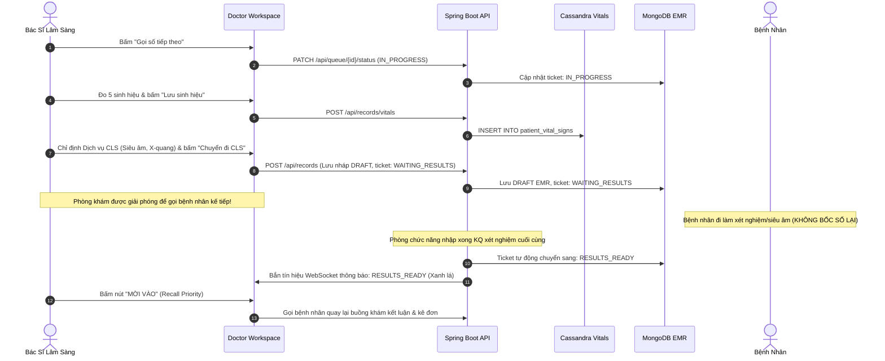

# BÁO CÁO TỔNG THỂ DỰ ÁN SMART CLINIC EMR
## HỆ THỐNG QUẢN LÝ PHÒNG KHÁM THÔNG MINH & BỆNH ÁN ĐIỆN TỬ
### KIẾN TRÚC CƠ SỞ DỮ LIỆU ĐA MÔ HÌNH (POLYGLOT PERSISTENCE NOSQL)

---

> **Tài liệu**: Đặc tả tổng hợp kiến trúc, nghiệp vụ, cơ sở dữ liệu và hiện trạng dự án  
> **Đề tài**: Xây dựng Hệ thống Quản lý Phòng khám Đa khoa & Bệnh án Điện tử (EMR) ứng dụng Polyglot Persistence NoSQL  
> **Công nghệ cốt lõi**: MongoDB 7.0, Redis 7.4, Apache Cassandra 4.1, Neo4j 5.26, Spring Boot (Java 17 LTS), Angular (Signals, NG-ZORRO)  
> **Mục đích**: Tài liệu căn bản phục vụ viết thuyết minh đồ án, báo cáo chuyên đề và tài liệu kỹ thuật chuyển giao  

---

## MỤC LỤC CHI TIẾT

1. [TỔNG QUAN DỰ ÁN & BỐI CẢNH NGHIÊN CỨU](#1-tổng-quan-dự-án--bối-cảnh-nghiên-cứu)
   - 1.1. Bối cảnh thực tiễn & 4 điểm nghẽn của phòng khám truyền thống
   - 1.2. Mục tiêu nghiên cứu & Giải pháp công nghệ
   - 1.3. Phạm vi hệ thống (In-Scope & Out-of-Scope)
2. [KIẾN TRÚC TỔNG THỂ HỆ THỐNG (SYSTEM ARCHITECTURE)](#2-kiến-trúc-tổng-thể-hệ-thống-system-architecture)
   - 2.1. Mô hình kiến trúc 3 tầng (Clean Layered Architecture)
   - 2.2. Ngăn xếp công nghệ chi tiết (Full Technology Stack)
   - 2.3. Cơ chế giao tiếp, đồng bộ & an toàn dữ liệu
   - 2.4. Kiến trúc bảo mật (Stateless JWT, RBAC, Data Encryption)
3. [THIẾT KẾ HỆ THỐNG ĐA CƠ SỞ DỮ LIỆU NOSQL (POLYGLOT PERSISTENCE)](#3-thiết-kế-hệ-thống-đa-cơ-sở-dữ-liệu-nosql-polyglot-persistence)
   - 3.1. Tổng quan chiến lược phân bổ dữ liệu
   - 3.2. Phân hệ MongoDB (Document Store) – Thực thể nghiệp vụ bán cấu trúc
   - 3.3. Phân hệ Redis (In-Memory Key-Value) – Tốc độ cao & Quản lý trạng thái tức thời
   - 3.4. Phân hệ Apache Cassandra (Wide-Column Store) – Chuỗi thời gian & Kiểm toán bất biến
   - 3.5. Phân hệ Neo4j (Graph Database) – Mạng lưới tri thức dược lý & Cảnh báo kê đơn
4. [MA TRẬN PHÂN QUYỀN HỆ THỐNG (RBAC MATRIX)](#4-ma-trận-phân-quyền-hệ-thống-rbac-matrix)
5. [28 QUY TẮC NGHIỆP VỤ BẤT BIẾN (BUSINESS RULES BR-01 ĐẾN BR-28)](#5-28-quy-tắc-nghiệp-vụ-bất-biến-business-rules-br-01-đến-br-28)
6. [ĐẶC TẢ CHI TIẾT 24 USE CASES HỆ THỐNG](#6-đặc-tả-chi-tiết-24-use-cases-hệ-thống)
   - 6.1. Phân hệ Bệnh nhân (UC01 -> UC08)
   - 6.2. Phân hệ Tiếp tân & Thu ngân (UC09 -> UC013)
   - 6.3. Phân hệ Bác sĩ lâm sàng (UC014 -> UC018)
   - 6.4. Phân hệ Quản trị viên (UC019 -> UC024)
7. [QUY TRÌNH NGHIỆP VỤ CỐT LÕI (CORE CLINICAL WORKFLOWS)](#7-quy-trình-nghiệp-vụ-cốt-lõi-core-clinical-workflows)
   - 7.1. Đặt lịch khám trực tuyến & Giữ chỗ slot thời gian thực
   - 7.2. Tiếp đón, cấp số STT & Điều phối hàng đợi buồng khám
   - 7.3. Khám lâm sàng, ghi sinh hiệu & Quy trình Cận lâm sàng (Recall Priority)
   - 7.4. Kê đơn thuốc, quét đồ thị DDI & Chống chỉ định ICD-10
   - 7.5. Khóa bệnh án EMR & Ghi nhận kiểm toán bất biến
   - 7.6. Tổng hợp viện phí, thanh toán VietQR động / Tiền mặt & Tự động trừ kho
8. [THIẾT KẾ GIAO DIỆN & TRẢI NGHIỆM NGƯỜI DÙNG (FRONTEND PALETTE & UX)](#8-thiết-kế-giao-diện--trải-nghiệm-người-dùng-frontend-palette--ux)
9. [DANH MỤC REST API & CẤU TRÚC MÃ NGUỒN](#9-danh-mục-rest-api--cấu-trúc-mã-nguồn)
10. [HƯỚNG DẪN CÀI ĐẶT, VẬN HÀNH & KIỂM THỬ](#10-hướng-dẫn-cài-đặt-vận-hành--kiểm-thử)

---

## 1. TỔNG QUAN DỰ ÁN & BỐI CẢNH NGHIÊN CỨU

### 1.1. Bối cảnh thực tiễn & 4 điểm nghẽn của phòng khám truyền thống
Tại các phòng khám đa khoa hiện nay, mô hình quản lý đơn khối (Monolith) dựa trên một Cơ sở dữ liệu Quan hệ (RDBMS) duy nhất bộc lộ 4 điểm nghẽn nghiêm trọng:
1. **Tắc nghẽn khâu tiếp đón và phân luồng**: Bệnh nhân phải xếp hàng lấy số cơ học, dễ ùn ứ vào các khung giờ cao điểm; tình trạng đặt trùng lịch hẹn (Double-booking) thường xuyên xảy ra do thiếu cơ chế khóa giữ chỗ tức thời.
2. **Rủi ro tương tác thuốc đối kháng (Drug-Drug Interaction - DDI)**: Bác sĩ tra cứu thủ công hoặc dựa vào kinh nghiệm, dễ bỏ sót các tương tác nguy hại và chống chỉ định thuốc đối với tiền sử bệnh nhân (nhất là các đơn thuốc từ 3 loại trở lên).
3. **Phân mảnh dữ liệu dấu hiệu sinh tồn (Vital Signs)**: Các chỉ số huyết áp, mạch, nhiệt độ, SpO2 được ghi nhận rời rạc qua từng lượt khám, không hỗ trợ trực quan hóa biểu đồ diễn tiến chuỗi thời gian liên tục.
4. **Hồ sơ bệnh án điện tử (EMR) thiếu linh hoạt**: Lược đồ quan hệ RDBMS cố định gây khó khăn lớn khi mở rộng thuộc tính bệnh án đặc thù cho các chuyên khoa (Tai Mũi Họng, Da liễu, Tim mạch, Sản phụ khoa,...). Bên cạnh đó, RDBMS dễ bị chỉnh sửa đè (Update in-place), không đảm bảo tính toàn vẹn pháp lý y tế (Medical Immutability).

### 1.2. Mục tiêu nghiên cứu & Giải pháp công nghệ
Dự án **Smart Clinic EMR** ứng dụng kiến trúc **Lưu trữ dữ liệu đa mô hình (Polyglot Persistence)**, phân bổ chuyên biệt trên **4 hệ thống CSDL NoSQL**:
- **MongoDB**: Đóng vai trò Document Store lưu trữ hồ sơ bệnh nhân, danh mục thuốc - dịch vụ, hóa đơn và bệnh án điện tử EMR bán cấu trúc.
- **Redis**: Đóng vai trò In-Memory Key-Value Store xử lý khóa giữ chỗ slot hẹn với TTL, hàng đợi thời gian thực FIFO, bộ đếm STT nguyên tử và JWT blacklist.
- **Apache Cassandra**: Đóng vai trò Wide-Column Family Store chịu tải ghi dữ liệu chuỗi thời gian 5 sinh hiệu và nhật ký kiểm toán y tế bất biến (Append-Only).
- **Neo4j**: Đóng vai trò Property Graph Database biểu diễn mạng lưới tri thức dược lý, giải thuật duyệt đồ thị phát hiện tương tác thuốc đối kháng và chống chỉ định theo mã bệnh ICD-10.

### 1.3. Phạm vi hệ thống (System Scope)
- **Thuộc phạm vi (In-Scope)**:
  - Cổng thông tin bệnh nhân (Patient Portal): Đặt lịch hẹn, theo dõi số thứ tự thời gian thực, xem lịch sử bệnh án, tra cứu hóa đơn.
  - Phân hệ tiếp đón & thu ngân: Check-in, cấp số thứ tự, in phiếu khám K80, tổng hợp viện phí, thanh toán Tiền mặt / VietQR động, xuất sổ thu ngân chuẩn file Microsoft Excel (`.xlsx`) và in biểu mẫu A4.
  - Bàn làm việc lâm sàng bác sĩ (Clinical Workspace): Tiếp nhận bệnh nhân, nhập 5 sinh hiệu, chẩn đoán ICD-10, chuyển làm cận lâm sàng (CLS) với cơ chế gọi lại ưu tiên (Recall Priority), kê đơn kiểm tra DDI qua đồ thị, khóa bệnh án EMR.
  - Phân hệ quản trị phòng khám: Quản lý nhân sự & phân quyền RBAC, danh mục kho dược & cảnh báo tồn $\le 10$, dịch vụ kỹ thuật, lịch trực bác sĩ, báo cáo dashboard.
- **Ngoài phạm vi (Out-of-Scope)**:
  - Điều trị nội trú và quản lý giường bệnh lưu viện.
  - Quản lý kho dược đa lô (Batches) và xuất nhập trước hạn trước (FEFO).
  - Tích hợp máy xét nghiệm tự động (LIS) và lưu trữ ảnh chẩn đoán chuẩn DICOM (PACS).
  - Thanh toán Bảo hiểm Y tế (BHYT) liên thông cổng giám định quốc gia.

---

## 2. KIẾN TRÚC TỔNG THỂ HỆ THỐNG (SYSTEM ARCHITECTURE)

### 2.1. Mô hình kiến trúc 3 tầng (Clean Layered Architecture)

```
+=============================================================================+
|                      TẦNG TRÌNH DIỄN (PRESENTATION TIER)                    |
|           Angular 22+ | NG-ZORRO (Ant Design) | Signals Reactive             |
|       [Bệnh Nhân]     [Lễ Tân / Thu Ngân]     [Bác Sĩ]     [Quản Trị Viên]   |
+======================================+======================================+
                                       | HTTPS / REST JSON & WebSocket STOMP
+======================================v======================================+
|                    TẦNG XỬ LÝ NGHIỆP VỤ (APPLICATION SERVICE TIER)          |
|                 Java Spring Boot 3.x/4.x (Java 17 LTS LTS)                  |
|  +-----------------------------------------------------------------------+  |
|  | Security Filter: Spring Security, JWT Stateless, RBAC, BCrypt Hash   |  |
|  +-----------------------------------------------------------------------+  |
|  | Controllers (14 REST Controllers): Auth, Patient, Queue, EMR, ...    |  |
|  +-----------------------------------------------------------------------+  |
|  | Service Layer (14 Services): Kiểm soát chặt chẽ 28 Business Rules     |  |
|  +-----------------------------------------------------------------------+  |
|  | Storage Abstraction Layer: @StorageMode.NoSql vs @StorageMode.Memory   |  |
+======================================+======================================+
                                       |
        +------------------+-----------+-----------+------------------+
        |                  |                       |                  |
        v                  v                       v                  v
+---------------+  +---------------+       +---------------+  +---------------+
|    MongoDB    |  |     Redis     |       |   Cassandra   |  |     Neo4j     |
| (Doc Store)   |  |  (In-Memory)  |       |  (Columnar)   |  |    (Graph)    |
| Port: 27017   |  |  Port: 6379   |       |  Port: 9042   |  |  Port: 7687   |
|---------------|  |---------------|       |---------------|  |---------------|
| • EMR Bệnh án |  | • Khóa slot   |       | • Chuỗi thời  |  | • Đồ thị tri  |
| • Bệnh nhân   |  |   hẹn (10p)   |       |   gian 5 sinh |  |   thức dược  |
| • Hóa đơn     |  | • STT Hàng    |       |   hiệu vitals |  | • Tương tác   |
| • Thuốc & Kho |  |   đợi Atomic  |       | • Audit Log   |  |   thuốc DDI   |
| • Dịch vụ KT  |  | • Blacklist   |       |   bất biến    |  | • Chống chỉ   |
| • Lịch hẹn    |  |   JWT token   |       |   Append-Only |  |   định ICD-10 |
+---------------+  +---------------+       +---------------+  +---------------+
```

### 2.2. Ngăn xếp công nghệ chi tiết (Full Technology Stack)

| Tầng hệ thống | Công nghệ sử dụng | Phiên bản | Vai trò & Mục đích ứng dụng |
|---|---|---|---|
| **Frontend UI** | Angular | 22.x+ | Kiến trúc Standalone Component, Signals state reactivity |
| **Giao diện & UI** | NG-ZORRO (Ant Design) | 22.1+ | Bộ component giao diện Luxury Healthcare Palette |
| **Bảng tính & Xuất file**| SheetJS (`xlsx`) | 0.18+ | Tạo tệp bảng tính Microsoft Excel OpenXML (`.xlsx`) nguyên bản |
| **Backend Core** | Spring Boot | 4.1.x / 3.x | Framework RESTful Web Service, Dependency Injection |
| **Ngôn ngữ Backend** | Java OpenJDK | 17 LTS | Nền tảng thực thi ổn định cho khối y tế doanh nghiệp |
| **Bảo mật** | Spring Security + JWT | 6.x | Xác thực Stateless qua Bearer Token, mã hóa mật khẩu BCrypt |
| **CSDL Tài liệu** | MongoDB | 7.0 | Document Store lưu trữ bệnh án EMR, danh mục, hóa đơn |
| **CSDL Bộ nhớ đệm** | Redis | 7.4-Alpine | In-memory key-value, distributed lock TTL, atomic counter |
| **CSDL Cột rộng** | Apache Cassandra | 4.1 | Wide-column store, time-series vitals & audit trails |
| **CSDL Đồ thị** | Neo4j Community | 5.26 | Graph Database, Cypher traversal tra cứu tương tác thuốc DDI |
| **Đóng gói Cụm** | Docker & Docker Compose | v29+ / v5+ | Khởi tạo và liên kết cụm 4 cơ sở dữ liệu trong môi trường dev/prod |

### 2.3. Cơ chế giao tiếp, đồng bộ & an toàn dữ liệu
- **Giao tiếp RESTful chuẩn hóa**: Toàn bộ dữ liệu trả về theo cấu trúc đóng gói duy nhất `ApiResponse<T>` với các trường: `success` (boolean), `message` (string), `data` (T), `timestamp` (ISO-8601).
- **Kiến trúc trừu tượng hóa tầng lưu trữ (Storage Mode Strategy)**:
  - `@StorageMode.NoSql`: Kích hoạt đồng thời 4 module Spring Data (`spring-boot-starter-data-mongodb`, `spring-boot-starter-data-redis`, `spring-boot-starter-data-cassandra`, `spring-boot-starter-data-neo4j`).
  - `@StorageMode.Memory`: Cơ chế Fallback chạy 100% bằng bộ nhớ RAM Thread-safe khi máy tính không đủ điều kiện chạy Docker.
- **Idempotent Updates**: Cơ chế đảm bảo tính lũy thừa khi trừ tồn kho dược và xác nhận thanh toán, chống trùng lặp dữ liệu khi gửi request nhiều lần.

### 2.4. Kiến trúc bảo mật (Stateless JWT, RBAC, Data Encryption)
- **Mã hóa dữ liệu nhạy cảm**: Số CMND/CCCD và Số điện thoại được kiểm soát tính duy nhất tại MongoDB.
- **Băm mật khẩu**: Sử dụng giải thuật BCrypt với Salt round $\ge 10$.
- **Token Lifecycle**: JWT Access Token có thời hạn 8 giờ; khi người dùng đăng xuất, ID định danh của token (`jti`) được đưa vào Redis Blacklist với TTL bằng thời gian còn lại của token nhằm vô hiệu hóa tức thời.

---

## 3. THIẾT KẾ HỆ THỐNG ĐA CƠ SỞ DỮ LIỆU NOSQL (POLYGLOT PERSISTENCE)

### 3.1. Tổng quan chiến lược phân bổ dữ liệu

| Đặc thù dữ liệu | Bài toán y tế thực tế | Tiêu chí kỹ thuật cần đáp ứng | Hệ CSDL NoSQL lựa chọn |
|---|---|---|:---:|
| Bán cấu trúc, lồng nhau (Embedded), schema mở rộng | Bệnh án EMR thay đổi linh hoạt theo từng chuyên khoa khám | Tính linh hoạt schema, Document BSON, hỗ trợ Index đa trường | **MongoDB** |
| Khóa phân tán, biến đổi nhanh, dữ liệu hết hạn theo thời gian | Giữ chỗ slot khám 10 phút, cấp STT hàng đợi, thu hồi JWT | Tốc độ truy xuất tức thời (< 15ms), hỗ trợ TTL tự hủy, Atomic INCR | **Redis** |
| Ghi nhiều (Write-heavy), chuỗi thời gian, dữ liệu bất biến | Chuỗi thời gian 5 sinh hiệu, nhật ký kiểm toán hành vi người dùng | Tốc độ ghi cực nhanh (< 10ms), Append-Only, Clustering Key theo thời gian | **Apache Cassandra** |
| Liên kết mạng lưới phức tạp nhiều-nhiều (N-N), tra cứu đường đi | Mạng lưới hoạt chất thuốc $\leftrightarrow$ nhóm dược $\leftrightarrow$ tương tác DDI | Khả năng duyệt đồ thị (Graph Traversal < 200ms) không cần JOIN bảng nặng nề | **Neo4j** |

---

### 3.2. Phân hệ MongoDB (Document Store - Port 27017, Database: `clinic_db`)

MongoDB quản lý 12 Collections cốt lõi của phòng khám với lược đồ JSON Schema Validator:

```
                            [patients] (Hồ sơ BN, CCCD, Tiền sử dị ứng)
                                |
             +------------------+-------------------+
             |                                      |
             v (1 - N)                              v (1 - N)
      [appointments]                         [queue_tickets] (STT hàng đợi)
   (Đặt lịch, slot, BS)                             |
                                                    v (1 - 1)
                                             [medical_records] (EMR)
                                             ├── 5 sinh hiệu (Snapshot)
                                             ├── ICD-10 diagnoses []
                                             ├── CLS services []
                                             └── prescriptions []
                                                    |
                                                    v (1 - 1)
                                                 [bills] (Hóa đơn viện phí)
                                                    ├── Items []
                                                    └── VietQR / Cash
                                                    |
                                                    v (Idempotent Trigger)
                                             [pharmacy_drugs] (Kho dược)
                                                    |
                                                    v
                                             [stock_transactions]
```

#### Chi tiết 12 Collections và Cấu trúc Index:
1. **`patients`**: Hồ sơ hành chính bệnh nhân & thông tin dị ứng thuốc.
   - *Indexes*: `{ patientCode: 1 } (Unique)`, `{ identityCardNumber: 1 } (Unique, Sparse)`, `{ phone: 1 }`, `{ email: 1 }`, `{ fullName: "text", patientCode: "text" }`.
2. **`staff_accounts`**: Tài khoản nhân sự y tế & ma trận phân quyền.
   - *Indexes*: `{ username: 1 } (Unique)`, `{ email: 1 } (Unique, Sparse)`, `{ role: 1, status: 1 }`.
3. **`appointments`**: Lịch hẹn khám chữa bệnh.
   - *Indexes*: `{ appointmentCode: 1 } (Unique)`, `{ patientId: 1, appointmentDate: -1 }`, `{ doctorId: 1, appointmentDate: 1, timeSlot: 1 }`, `{ status: 1 }`.
4. **`queue_tickets`**: Phiếu tiếp nhận hàng đợi khám.
   - *Indexes*: `{ ticketNumber: 1 }`, `{ status: 1, roomName: 1, sortOrder: 1 }`, `{ patientId: 1 }`.
5. **`medical_records`**: Bệnh án điện tử EMR lồng ghép đầy đủ: Chẩn đoán ICD-10, Chỉ định CLS, Đơn thuốc, Cờ khóa `isLocked`.
   - *Indexes*: `{ visitCode: 1 } (Unique)`, `{ patientId: 1, visitDate: -1 }`, `{ 'diagnoses.code': 1 }`, `{ department: 1, visitDate: -1 }`.
6. **`bills`**: Hóa đơn viện phí (Tiền khám + Tiền kỹ thuật + Tiền thuốc).
   - *Indexes*: `{ billCode: 1 } (Unique)`, `{ patientId: 1, createdAt: -1 }`, `{ paymentStatus: 1, createdAt: -1 }`.
7. **`pharmacy_drugs`**: Danh mục biệt dược & số lượng tồn kho khả dụng.
   - *Indexes*: `{ code: 1 } (Unique)`, `{ status: 1, stockQuantity: 1 }`, `{ name: "text", activeIngredient: "text" }`.
8. **`stock_transactions`**: Nhật ký biến động kho thuốc (Nhập kho, Xuất kho, Trừ kho tự động theo đơn).
   - *Indexes*: `{ drugId: 1, timestamp: -1 }`.
9. **`medical_services`**: Danh mục dịch vụ kỹ thuật & bảng giá niêm yết.
   - *Indexes*: `{ serviceCode: 1 } (Unique)`, `{ category: 1, active: 1 }`.
10. **`doctor_schedules`**: Lịch trực và ca làm việc của bác sĩ.
    - *Indexes*: `{ doctorId: 1, date: 1, shift: 1 } (Unique)`, `{ roomName: 1, date: 1, shift: 1 }`.
11. **`notifications`**: Thông báo tức thời trong ứng dụng (Nhắc hẹn, Gọi số, Hóa đơn).
    - *Indexes*: `{ userId: 1, isRead: 1 }`.
12. **`counters`**: Bộ đếm nguyên tử sinh mã tuần tự (`HD-2026-xxxx`, `BN-2026-xxxx`).

---

### 3.3. Phân hệ Redis (In-Memory Key-Value - Port 6379)

Redis đóng vai trò lớp xử lý tức thời với các cấu trúc dữ liệu chuyên biệt:

| Key Pattern | Cấu trúc dữ liệu | Thời gian sống (TTL) | Mục đích nghiệp vụ |
|---|---|---|---|
| `slot:lock:{doctorId}:{date}:{slot}` | `String` (Giá trị: `patientId`) | `600s (10 phút)` | Khóa giữ chỗ slot lịch hẹn khi bệnh nhân đang đặt lịch trực tuyến, chống xung đột đặt trùng |
| `counter:ticket:{prefix}:{date}` | `String` (Atomic Integer) | `129.600s (36 giờ)` | Bộ đếm số thứ tự hàng đợi tự tăng (`INCR`), cấp số STT buồng khám như A-001, B-005 |
| `otp:reset:{email}` | `Hash` (`{code, failedAttempts}`) | `300s (5 phút)` | Lưu trữ mã OTP 6 số phục hồi mật khẩu, kiểm soát số lần thử sai $\le 3$ lần |
| `auth:blacklist:{jti}` | `String` (Giá trị: `"1"`) | Bằng thời gian sống còn lại của JWT | Thu hồi token ngay khi người dùng bấm Đăng xuất |
| `leaderboard:doctors:{yyyy-MM}` | `Sorted Set (ZSet)` (Score = số ca khám) | `34.560.000s (400 ngày)` | Xếp hạng bác sĩ có số lượt khám nhiều nhất trong tháng |

---

### 3.4. Phân hệ Apache Cassandra (Wide-Column Store - Port 9042, Keyspace: `clinic_keyspace`)

Cassandra được thiết kế theo tư duy **Query-First Modeling** (thiết kế bảng dựa trên câu truy vấn cần thực thi, chấp nhận nhân bản dữ liệu để tối ưu tốc độ đọc/ghi):

#### 1. Bảng `patient_vital_signs` (Chuỗi thời gian sinh hiệu 5 chỉ số):
```sql
CREATE TABLE clinic_keyspace.patient_vital_signs (
    patient_id               text,
    recorded_at              timestamp,
    visit_id                 text,
    record_id                text,
    doctor_name              text,
    blood_pressure_systolic  int,      -- Huyết áp tâm thu (mmHg)
    blood_pressure_diastolic int,      -- Huyết áp tâm trương (mmHg)
    heart_rate               int,      -- Mạch (lần/phút)
    temperature              double,   -- Thân nhiệt (°C)
    weight_kg                double,   -- Cân nặng (kg)
    height_cm                double,   -- Chiều cao (cm)
    bmi                      double,   -- Chỉ số khối cơ thể
    spo2                     double,   -- Nồng độ oxy trong máu (%)
    PRIMARY KEY ((patient_id), recorded_at)
) WITH CLUSTERING ORDER BY (recorded_at DESC);
```
- **Partition Key**: `patient_id` $\rightarrow$ Toàn bộ các lần đo của 1 bệnh nhân được lưu trong cùng 1 partition node.
- **Clustering Key**: `recorded_at DESC` $\rightarrow$ Trích xuất nhanh $N$ lần đo gần nhất để vẽ biểu đồ diễn tiến ECharts mà không cần tốn chi phí CPU để Sort.

#### 2. Cụm 3 Bảng Nhật Ký Kiểm Toán Y Tế Bất Biến (Audit Trail Append-Only):
Để phục vụ 3 loại câu truy vấn thanh tra y tế khác nhau mà không cần `ALLOW FILTERING`, hệ thống ghi đồng bộ vào 3 bảng bằng cơ chế **Logged Batch Statement**:
- `audit_logs_by_entity`: Phục vụ xem toàn bộ lịch sử biến động của 1 bản ghi bệnh án EMR hoặc 1 hóa đơn:
  `PRIMARY KEY ((entity_type, entity_id), event_id)` với `CLUSTERING ORDER BY (event_id DESC)`.
- `audit_logs_by_actor`: Phục vụ thanh tra toàn bộ thao tác của 1 nhân viên trong 1 ngày làm việc:
  `PRIMARY KEY ((actor_id, event_date), event_id)` với `CLUSTERING ORDER BY (event_id DESC)`.
- `audit_logs_by_action`: Phục vụ giám sát toàn bộ các thao tác nhạy cảm (như `LOCK_EMR`, `PAY`, `CANCEL`):
  `PRIMARY KEY ((action_type, event_date), event_id)` với `CLUSTERING ORDER BY (event_id DESC)`.

---

### 3.5. Phân hệ Neo4j (Graph Database - Port 7474 Web, Port 7687 Bolt)

Neo4j lưu trữ mạng lưới tri thức dược học, bệnh học và tương tác đối kháng.

#### Mô hình Nút (Nodes) & Nhãn (Labels):
1. `(:Drug {code, name, strength, source})`: Biệt dược lưu hành tại phòng khám (mã `code` ánh xạ 1:1 với `pharmacy_drugs.code` trong MongoDB).
2. `(:ActiveIngredient {name, nameVi})`: Hoạt chất dược lý chính (ví dụ: *Amoxicillin, Clavulanic Acid, Ibuprofen, Warfarin*).
3. `(:DrugClass {name, nameVi})`: Phân nhóm dược lý (ví dụ: *NSAID, Beta-lactam, Kháng đông, Kháng sinh Quinolone*).
4. `(:Disease {icdCode, name})`: Danh mục bệnh lý chuẩn quốc tế theo mã ICD-10 (ví dụ: *I10 - Tăng huyết áp vô căn, K25 - Loét dạ dày*).

#### Mô hình Cạnh (Relationships):
- `(:Drug)-[:CONTAINS]->(:ActiveIngredient)`: Thuốc chứa hoạt chất.
- `(:ActiveIngredient)-[:BELONGS_TO]->(:DrugClass)`: Hoạt chất thuộc nhóm dược lý.
- `(:ActiveIngredient)-[:INTERACTS_WITH {severity, title, mechanism, clinicalEffect, recommendation}]->(:ActiveIngredient)`: Tương tác đối kháng giữa 2 hoạt chất (Mức độ: `CRITICAL`, `MAJOR`, `MODERATE`).
- `(:ActiveIngredient)-[:TREATS]->(:Disease)`: Hoạt chất chỉ định điều trị cho bệnh lý.
- `(:ActiveIngredient)-[:CONTRAINDICATED_IN {reason}]->(:Disease)`: Hoạt chất chống chỉ định với bệnh lý.

#### Câu truy vấn Cypher cốt lõi kiểm tra tương tác thuốc (DDI):
```cypher
MATCH (a:ActiveIngredient)-[r:INTERACTS_WITH]-(b:ActiveIngredient)
WHERE a.name IN $ingredients AND b.name IN $ingredients AND a.name < b.name
RETURN a.name AS HoatChatA, b.name AS HoatChatB, 
       r.severity AS MucDo, r.title AS TenTuongTac,
       r.mechanism AS CoChe, r.recommendation AS KhuyenNghi;
```

#### Câu truy vấn Cypher kiểm tra chống chỉ định theo mã bệnh ICD-10 của bệnh nhân:
```cypher
MATCH (a:ActiveIngredient)-[r:CONTRAINDICATED_IN]->(s:Disease)
WHERE a.name IN $ingredients
  AND any(code IN $icdCodes WHERE code = s.icdCode OR code STARTS WITH s.icdCode + '.')
RETURN a.name AS HoatChat, s.icdCode AS MaBenh, s.name AS TenBenh, r.reason AS LyDoChongChiDinh;
```

---

## 4. MA TRẬN PHÂN QUYỀN HỆ THỐNG (RBAC MATRIX)

Hệ thống thiết lập phân quyền chặt chẽ theo 4 vai trò chuẩn y tế:

| Mã UC | Tên Ca Sử Dụng (Use Case) | Bệnh nhân (`PATIENT`) | Lễ tân / Thu ngân (`RECEPTIONIST`) | Bác sĩ (`DOCTOR`) | Quản trị viên (`ADMIN`) |
|:---:|---|:---:|:---:|:---:|:---:|
| **UC01** | Quản lý thông tin cá nhân & Đổi mật khẩu | ✓ | ✓ | ✓ | ✓ |
| **UC02** | Đặt lịch hẹn khám trực tuyến (Stepper 4 bước) | ✓ | | | |
| **UC03** | Quản lý lịch hẹn cá nhân (Dời / Hủy lịch) | ✓ | | | |
| **UC04** | Theo dõi tiến trình lượt khám thời gian thực | ✓ | | | |
| **UC05** | Tra cứu chi tiết hồ sơ bệnh án cá nhân | ✓ | | | |
| **UC06** | Tra cứu lịch sử khám chữa bệnh | ✓ | | | |
| **UC07** | Theo dõi chi tiết hóa đơn viện phí cá nhân | ✓ | | | |
| **UC08** | Nhận thông báo hệ thống (SMS/In-app) | ✓ | ✓ | ✓ | ✓ |
| **UC09** | Tiếp nhận bệnh nhân & Cấp STT (In phiếu K80) | | ✓ | | |
| **UC010** | Quản lý điều phối lịch hẹn toàn phòng khám | | ✓ | | |
| **UC011** | Điều phối hàng đợi buồng khám & Đẩy ca ưu tiên | | ✓ | | |
| **UC012** | Quản lý hồ sơ bệnh nhân (CCCD, SĐT, Dị ứng) | | ✓ | | |
| **UC013** | Tổng hợp viện phí, Thu tiền mặt & VietQR, Xuất Excel | | ✓ | | |
| **UC014** | Quản lý khám bệnh (5 sinh hiệu, ICD-10, Triệu chứng) | | | ✓ | |
| **UC015** | Quản lý bệnh án EMR & Khóa bất biến sau khám | | | ✓ | |
| **UC016** | Chỉ định dịch vụ kỹ thuật / Cận lâm sàng (CLS) | | | ✓ | |
| **UC017** | Xem kết quả CLS & Bác sĩ gọi lại ưu tiên (Recall) | | | ✓ | |
| **UC018** | Kê đơn thuốc & Kiểm tra cảnh báo DDI qua đồ thị | | | ✓ | |
| **UC019** | Quản lý tài khoản nhân sự & Phân quyền RBAC | | | | ✓ |
| **UC020** | Quản lý danh mục thuốc phòng khám | | | | ✓ |
| **UC021** | Quản lý tồn kho thuốc & Cảnh báo tồn $\le 10$ | | | | ✓ |
| **UC022** | Quản lý danh mục dịch vụ kỹ thuật & Bảng giá | | | | ✓ |
| **UC023** | Quản lý phân ca làm việc & Lịch trực bác sĩ | | | | ✓ |
| **UC024** | Báo cáo thống kê (Doanh thu, Lượt khám, Dược) | | | | ✓ |

---

## 5. 28 QUY TẮC NGHIỆP VỤ BẤT BIẾN (BUSINESS RULES BR-01 ĐẾN BR-28)

- **BR-01 (Kiểm soát truy cập)**: Người dùng chỉ được truy cập chức năng đúng với vai trò được cấp; chặn tuyệt đối truy cập trái phép qua URL hoặc API.
- **BR-02 (Bảo mật hồ sơ cá nhân)**: Bệnh nhân chỉ xem được lịch hẹn, bệnh án và hóa đơn của chính mình.
- **BR-03 (Mã định danh duy nhất)**: Mỗi bệnh nhân được cấp một mã duy nhất `patientCode`; hệ thống bắt buộc đối soát CCCD và SĐT trước khi tạo mới để chống trùng hồ sơ.
- **BR-04 (Hợp lệ hóa lịch hẹn)**: Lịch hẹn bắt buộc phải có thông tin bệnh nhân, bác sĩ, ngày khám, khung giờ còn trống và trạng thái hợp lệ.
- **BR-05 (Chống đặt trùng slot - Concurrency Lock)**: Mỗi khung giờ khám của bác sĩ có giới hạn số lượng bệnh nhân; Redis Lock (TTL = 10 phút) giữ chỗ tạm thời trong lúc thao tác.
- **BR-06 (Luồng khám vãng lai)**: Bệnh nhân không hẹn trước được tiếp nhận theo luồng Walk-in và cấp số thứ tự kế tiếp trong ca.
- **BR-07 (Chu trình Hàng đợi & Chuyển tiếp Cận lâm sàng)**:
  $$\text{WAITING} \longrightarrow \text{IN\_PROGRESS} \rightleftharpoons \begin{matrix} \text{WAITING\_RESULTS (Đi làm CLS)} \\ \downarrow \\ \text{RESULTS\_READY (Đã có đủ KQ)} \end{matrix} \longrightarrow \text{COMPLETED}$$
  - Khi bác sĩ chỉ định CLS, bệnh án được lưu nháp (`DRAFT`), vé khám chuyển sang `WAITING_RESULTS` để giải phóng phòng khám gọi ca kế tiếp.
  - **Bệnh nhân tuyệt đối không phải bốc số lại tại quầy tiếp đón** khi đã làm xong xét nghiệm/chụp chiếu.
  - Khi có đủ kết quả, vé tự động chuyển sang `RESULTS_READY` (xanh lá); bác sĩ áp dụng **Recall Priority** gọi bệnh nhân vào kết luận ngay.
- **BR-08 (Tính duy nhất của STT khám)**: Số thứ tự hàng đợi gắn liền với ngày khám và phòng khám, không bị nhảy số nhầm lẫn giữa các ngày.
- **BR-09 (Tính toàn vẹn dấu hiệu sinh tồn)**: 5 chỉ số sinh hiệu (Huyết áp, Mạch, Nhiệt độ, Chiều cao, Cân nặng $\rightarrow$ BMI) được ghi nhận kèm dấu thời gian và lưu trữ vào Cassandra.
- **BR-10 (Chuẩn hóa chẩn đoán ICD-10)**: Mọi chẩn đoán xác định bắt buộc chọn mã chuẩn ICD-10 từ danh mục y tế quốc tế.
- **BR-11 (Hợp lệ hóa dịch vụ kỹ thuật)**: Dịch vụ chỉ định phải thuộc danh mục đang hoạt động kèm đơn giá niêm yết hợp lệ.
- **BR-12 (Cảnh báo tương tác thuốc DDI)**: Hệ thống tự động quét tương tác qua Neo4j; nếu có tương tác `CRITICAL` hoặc `MAJOR`, giao diện kích hoạt Modal cảnh báo màu đỏ Burgundy bắt buộc bác sĩ xác nhận trách nhiệm.
- **BR-13 (Cảnh báo tiền sử dị ứng)**: Banner tiền sử dị ứng thuốc màu đỏ Burgundy bắt buộc hiển thị nổi bật ở đầu hồ sơ khám của bệnh nhân.
- **BR-14 (Cấu trúc đơn thuốc hợp lệ)**: Đơn thuốc bắt buộc có đủ liều dùng, số lượng, cách dùng, thời điểm uống và thời gian điều trị.
- **BR-15 (Kiểm tra khả dụng tồn kho dược)**: Hệ thống kiểm tra số lượng tồn khả dụng trong MongoDB trước khi cho phép bác sĩ lưu đơn thuốc.
- **BR-16 (Tổng hợp viện phí 3 khoản)**: Hóa đơn được tính đúng công thức:
  $$\text{Tổng viện phí} = \text{Tiền khám} + \text{Tiền dịch vụ kỹ thuật (CLS)} + \text{Tiền thuốc}$$
- **BR-17 (Đa kênh thanh toán)**: Hỗ trợ 2 phương thức: Tiền mặt tại quầy (tự động tính tiền thối) hoặc mã VietQR động.
- **BR-18 (Đối soát chuyển khoản VietQR)**: Hóa đơn VietQR chỉ chuyển sang `PAID` sau khi thu ngân đối soát biến động tài khoản và bấm xác nhận đã nhận tiền.
- **BR-19 (Tự động trừ kho thuốc Idempotent)**: Trừ kho thuốc tự động kích hoạt **chỉ khi hóa đơn chuyển sang ĐÃ THANH TOÁN (`PAID`)**, có cơ chế chống trừ lặp khi click nhiều lần.
- **BR-20 (Kiểm soát hoàn trả viện phí)**: Hóa đơn đã thanh toán không được tự ý sửa đổi; việc hủy/hoàn trả bắt buộc có sự phê duyệt của Quản trị viên kèm biên bản nhập lại kho dược.
- **BR-21 (Cảnh báo cận kiệt tồn kho dược)**: Khi số lượng tồn thuốc $\le 10$ đơn vị, hệ thống tự động phát sinh cảnh báo đỏ trên trang quản trị kho dược.
- **BR-22 (Minh bạch kiểm toán kho)**: Mọi thao tác nhập/xuất/điều chỉnh kho đều bắt buộc lưu vết vào bảng `stock_transactions` kèm lý do và người thực hiện.
- **BR-23 (Khóa bất biến bệnh án EMR)**: Bệnh án ở trạng thái `COMPLETED` sẽ **bị khóa trực tiếp, tuyệt đối không cho sửa đè hoặc xóa**. Mọi đính chính sau đó chỉ được ghi nhận dưới dạng Phụ lục bổ sung (Versioning).
- **BR-24 (Bảo toàn lịch sử - Không xóa vật lý danh mục)**: Thuốc hoặc Dịch vụ đã phát sinh giao dịch chỉ được chuyển sang trạng thái `Ngừng hoạt động / Ngừng kinh doanh`, tuyệt đối cấm xóa vật lý (Hard Delete) khỏi database.
- **BR-25 (Thông báo đồng bộ khi đổi lịch)**: Mọi thao tác dời hoặc hủy lịch khám phải cập nhật trạng thái và tự động gửi thông báo đến bệnh nhân và bác sĩ.
- **BR-26 (Bảo mật phạm vi báo cáo)**: Báo cáo thống kê doanh thu và lượt khám chỉ tổng hợp trong phạm vi quyền hạn và khung thời gian được cho phép.
- **BR-27 (Xác thực dữ liệu đầu vào)**: Toàn bộ dữ liệu request được kiểm tra hợp lệ (Bean Validation: `@NotNull`, `@Pattern`, `@Min`) trước khi chuyển xuống tầng CSDL NoSQL.
- **BR-28 (Nhật ký kiểm toán y tế bất biến - Audit Trail)**: Mọi thao tác trọng yếu (khám bệnh, khóa EMR, thu tiền, hủy hóa đơn) bắt buộc ghi vào bảng Append-Only trên Apache Cassandra (`audit_logs_by_entity/actor/action`).

---

## 6. ĐẶC TẢ CHI TIẾT 24 USE CASES HỆ THỐNG

### 6.1. Phân hệ Bệnh nhân (Patient Portal)
- **UC01 - Quản lý tài khoản cá nhân**: Cập nhật thông tin hành chính, đổi mật khẩu, quản lý avatar.
- **UC02 - Đặt lịch hẹn trực tuyến**: Quy trình 4 bước (Chuyên khoa $\rightarrow$ Bác sĩ $\rightarrow$ Ngày/Giờ còn trống $\rightarrow$ Xác nhận). Khóa slot Redis 10 phút.
- **UC03 - Quản lý lịch hẹn**: Xem lịch hẹn sắp tới, thực hiện Dời lịch hoặc Hủy hẹn trực tuyến trước ca khám.
- **UC04 - Theo dõi lượt khám realtime**: Theo dõi số thứ tự cá nhân trên hàng đợi phòng khám theo thời gian thực (`WAITING` $\rightarrow$ `IN_PROGRESS` $\rightarrow$ `COMPLETED`).
- **UC05 - Tra cứu hồ sơ khám cá nhân**: Xem chi tiết kết quả chẩn đoán ICD-10, các chỉ định kỹ thuật và toa thuốc của phiên khám.
- **UC06 - Tra cứu lịch sử khám bệnh**: Bộ lọc nâng cao tìm kiếm bệnh sử cũ theo chuyên khoa, bác sĩ hoặc năm điều trị.
- **UC07 - Theo dõi hóa đơn viện phí**: Xem chi tiết số tiền viện phí, phương thức thanh toán và trạng thái biên lai điện tử.
- **UC08 - Nhận thông báo hệ thống**: Tiếp nhận thông báo nhắc lịch khám, thông báo gọi số vào phòng khám và thông báo thanh toán.

### 6.2. Phân hệ Tiếp tân & Thu ngân (Reception & Cashier)
- **UC09 - Tiếp nhận bệnh nhân & Cấp số STT**: Tìm kiếm bệnh nhân theo CCCD/SĐT hoặc tạo mới hồ sơ; check-in lịch hẹn hoặc tiếp nhận vãng lai; cấp số thứ tự tự động và in phiếu khám nhiệt K80.
- **UC010 - Quản lý lịch hẹn phòng khám**: Theo dõi danh sách lịch hẹn toàn phòng khám theo ngày, hỗ trợ dời hoặc hủy hẹn tại quầy.
- **UC011 - Điều phối hàng đợi phòng khám**: Giám sát danh sách chờ khám của các phòng; điều phối đưa ca ưu tiên/cấp cứu lên vị trí đầu hàng đợi.
- **UC012 - Quản lý hồ sơ bệnh nhân**: Tra cứu danh bạ bệnh nhân toàn hệ thống, cập nhật thông tin hành chính và tiền sử dị ứng thuốc.
- **UC013 - Quản lý hóa đơn & Thanh toán viện phí**: Lập hóa đơn viện phí; xử lý thu tiền mặt (tự tính tiền thừa) hoặc VietQR động; in biên lai điện tử A5/K80; tự động trừ tồn kho dược; xuất sổ theo dõi thu ngân ra file Excel (`.xlsx`) nguyên bản.

### 6.3. Phân hệ Bác sĩ lâm sàng (Doctor Clinical Workspace)
- **UC014 - Quản lý khám bệnh lâm sàng**: Gọi bệnh nhân tiếp theo vào phòng; ghi nhận 5 chỉ số sinh hiệu (lưu chuỗi thời gian Cassandra); chẩn đoán ICD-10; hoàn tất ca khám.
- **UC015 - Quản lý bệnh án điện tử EMR**: Xem tóm tắt tiền sử bệnh; khóa bất biến bệnh án sau khi hoàn tất phiên khám (BR-23).
- **UC016 - Chỉ định dịch vụ kỹ thuật / Cận lâm sàng**: Chọn dịch vụ cận lâm sàng (siêu âm, X-quang, xét nghiệm máu); bấm chuyển đi CLS, lưu nháp bệnh án và giải phóng phòng khám.
- **UC017 - Xem kết quả CLS & Gọi lại ưu tiên (Recall Priority)**: Tự động phát hiện khi đã có đủ kết quả CLS (`RESULTS_READY`); bác sĩ bấm gọi lại ưu tiên mời bệnh nhân vào buồng khám kết luận ngay mà không cần xếp hàng lại từ đầu.
- **UC018 - Kê đơn thuốc & Cảnh báo tương tác DDI**: Kê đơn thuốc điều trị; hệ thống tự động gọi Neo4j kiểm tra tương tác thuốc đối kháng (DDI) và chống chỉ định bệnh lý ICD-10, hiển thị cảnh báo đỏ Burgundy trước khi lưu đơn.

### 6.4. Phân hệ Quản trị viên (Admin Portal)
- **UC019 - Quản lý người dùng & Phân quyền RBAC**: Quản lý danh sách tài khoản bác sĩ, lễ tân, thu ngân; gán vai trò và phân quyền hạn; khóa/mở khóa tài khoản.
- **UC020 - Quản lý danh mục thuốc**: Thêm mới biệt dược, cập nhật giá bán, chuyển cờ ngừng kinh doanh (không xóa vật lý).
- **UC021 - Quản lý tồn kho thuốc**: Cập nhật nhập kho bổ sung; giám sát số lượng tồn khả dụng thời gian thực; hiển thị cảnh báo đỏ cho các mặt hàng tồn kho $\le 10$ đơn vị.
- **UC022 - Quản lý dịch vụ kỹ thuật**: Thêm mới dịch vụ, thiết lập đơn giá niêm yết, bật/tắt trạng thái cung ứng dịch vụ.
- **UC023 - Quản lý phân ca & Lịch trực bác sĩ**: Thiết lập ca làm việc (Sáng, Chiều, Tối) theo từng bác sĩ và phòng khám, ngăn chặn xung đột trùng lịch trực.
- **UC024 - Báo cáo thống kê hoạt động**: Thống kê doanh thu viện phí, cơ cấu thanh toán Tiền mặt vs VietQR, số lượt khám theo chuyên khoa/bác sĩ, xuất báo cáo điều hành.

---

## 7. QUY TRÌNH NGHIỆP VỤ CỐT LÕI (CORE CLINICAL WORKFLOWS)

### 7.1. Đặt lịch khám trực tuyến & Giữ chỗ slot thời gian thực
1. Bệnh nhân truy cập trang đặt lịch, chọn Chuyên khoa $\rightarrow$ chọn Bác sĩ $\rightarrow$ chọn Ngày khám.
2. Hệ thống truy vấn lịch trực bác sĩ từ MongoDB (`doctor_schedules`).
3. Khi bệnh nhân chọn một khung giờ (Ví dụ: 08:30 - 09:00), Backend gửi lệnh đến **Redis**:
   `SET slot:lock:doc-01:2026-11-05:08:30 pat-01 NX EX 600`
4. Nếu thành công: Khung giờ được khóa tạm 10 phút để bệnh nhân điền lý do khám. Nếu đã có người khác chọn: Hệ thống báo bận ngay lập tức.
5. Khi bệnh nhân xác nhận: Tạo bản ghi vào collection `appointments` (MongoDB), giải phóng Redis Lock và gửi thông báo xác nhận thành công.

### 7.2. Tiếp đón, cấp số STT & Điều phối hàng đợi buồng khám
1. Tại quầy tiếp đón, nhân viên tra cứu hồ sơ bệnh nhân bằng CCCD hoặc SĐT.
2. Nếu có lịch hẹn trước: Bấm xác nhận check-in $\rightarrow$ chuyển trạng thái hẹn sang `CHECKED_IN`.
3. Hệ thống gọi **Redis Atomic Counter**: `INCR counter:ticket:A:2026-11-05` để sinh số thứ tự tự động (Ví dụ: `A-012`).
4. Bản ghi hàng đợi được lưu vào collection `queue_tickets` (MongoDB) với trạng thái `WAITING`.
5. Máy in tại quầy tự động in phiếu khám nhiệt khổ K80 gồm: Số STT, Mã vé, Họ tên, Phòng khám, Bác sĩ chỉ định, Mã vạch Barcode/QR.

### 7.3. Khám lâm sàng & Quy trình Cận lâm sàng (Recall Priority - BR-07)



### 7.4. Kê đơn thuốc, quét đồ thị DDI & Chống chỉ định ICD-10
1. Bác sĩ chẩn đoán bệnh theo mã ICD-10 (Ví dụ: `I10` - Tăng huyết áp, `K25` - Loét dạ dày).
2. Bác sĩ tìm kiếm và thêm các loại thuốc vào toa (Ví dụ: *Aspirin 81mg* và *Ibuprofen 400mg*).
3. Backend trích xuất danh sách hoạt chất và gửi truy vấn Cypher sang **Neo4j**:
   ```cypher
   MATCH (a:ActiveIngredient)-[r:INTERACTS_WITH]-(b:ActiveIngredient)
   WHERE a.name IN ['Aspirin', 'Ibuprofen']
   RETURN r.severity, r.title, r.mechanism, r.recommendation;
   ```
4. Neo4j phát hiện tương tác đối kháng mức độ nghiêm trọng (`MAJOR - Tăng nguy cơ xuất huyết tiêu hóa và suy giảm tác dụng bảo vệ tim mạch`).
5. Giao diện Frontend lập tức bật Modal cảnh báo màu đỏ Burgundy (`DrugInteractionModalComponent`), yêu cầu bác sĩ đọc kỹ khuyến nghị và bắt buộc tích chọn xác nhận trách nhiệm mới cho phép lưu toa thuốc.

### 7.5. Khóa bệnh án EMR & Ghi nhận kiểm toán bất biến
1. Bác sĩ hoàn tất phiên khám và bấm **"Hoàn tất ca khám & Khóa EMR"**.
2. Backend thực thi đồng thời:
   - Cập nhật bản ghi trong MongoDB: `isLocked = true`, `status = COMPLETED`. Kể từ thời điểm này, mọi thao tác sửa/xóa trực tiếp đều bị từ chối 100%.
   - Ghi một bản ghi nhật ký kiểm toán bất biến sang **Apache Cassandra**:
     ```sql
     INSERT INTO audit_logs_by_entity (entity_type, entity_id, event_id, action_type, actor_id, actor_name, action_time)
     VALUES ('EMR', 'REC-2026-0042', now(), 'LOCK_EMR', 'usr-doc-01', 'TS.BS Trần Minh Hoàng', toTimestamp(now()));
     ```

### 7.6. Tổng hợp viện phí, thanh toán VietQR / Tiền mặt & Tự động trừ kho
1. Sau khi bác sĩ khóa EMR, hệ thống tự động sinh một hóa đơn viện phí (`bills`) trong MongoDB:
   $$\text{Tổng tiền} = \text{Tiền khám (150.000₫)} + \text{Tiền CLS (350.000₫)} + \text{Tiền thuốc (220.000₫)} = 720.000₫$$
2. Bệnh nhân đến quầy thu ngân:
   - **Nếu trả Tiền mặt**: Thu ngân nhập số tiền khách đưa (ví dụ: 1.000.000₫), hệ thống tự tính tiền thừa (280.000₫) và bấm "Xác nhận thu tiền".
   - **Nếu trả VietQR**: Hệ thống tạo mã QR động VietQR với đầy đủ số tài khoản, số tiền chính xác (720.000₫) và cú pháp nội dung chuyển khoản `HD20260042`. Thu ngân đối soát tài khoản và bấm "Xác nhận đã nhận tiền".
3. **Cơ chế Idempotent trừ kho tự động**: Ngay khi hóa đơn chuyển sang trạng thái `PAID`, Backend tự động trừ tồn kho khả dụng của các mặt hàng thuốc trong collection `pharmacy_drugs` (MongoDB) và lưu lịch sử vào `stock_transactions`.
4. Thu ngân bấm **"In biên lai"** để xuất phiếu thu K80/A5 cho bệnh nhân, hoặc bấm **"Xuất sổ thu ngân"** để tải về tệp Microsoft Excel (`.xlsx`) phục vụ bàn giao ca.

---

## 8. THIẾT KẾ GIAO DIỆN & TRẢI NGHIỆM NGƯỜI DÙNG (FRONTEND PALETTE & UX)

Giao diện được xây dựng theo ngôn ngữ thiết kế **Luxury Healthcare Palette** chuẩn mực cho các cơ sở y tế quốc tế:

| Tên tông màu | Mã màu HEX | Ý nghĩa nghiệp vụ & Vị trí ứng dụng |
|---|---|---|
| **Deep Teal** | `#0E4A55` | Màu nhận diện chủ đạo: Header thương hiệu, nút bấm chính (Primary Action), trạng thái `IN_PROGRESS` |
| **Ink Slate** | `#1C2733` | Màu nền thanh điều hướng (Sidebar), Typography tiêu đề, viền thẻ card dữ liệu |
| **Champagne Gold**| `#B8955A` | Màu điểm nhấn sang trọng: Thẻ VIP, số thứ tự khám, trạng thái chờ `WAITING` |
| **Ivory** | `#F6F3EC` | Màu nền canvas tổng thể, tạo cảm giác nhẹ nhàng, sạch sẽ, giảm căng thẳng thị giác |
| **Sage** | `#5E8B7E` | Màu thành công y tế: Trạng thái `COMPLETED`, `RESULTS_READY`, chỉ số sinh hiệu bình thường |
| **Burgundy** | `#9B3D45` | Màu cảnh báo nghiêm trọng: Cảnh báo tương tác thuốc DDI, dị ứng thuốc, sinh hiệu vượt ngưỡng nguy kịch |

---

## 9. DANH MỤC REST API & CẤU TRÚC MÃ NGUỒN

### 9.1. Danh sách 14 REST Controllers & Endpoints tiêu biểu

| STT | Tên REST Controller | Base Path | Chức năng nghiệp vụ chính |
|:---:|---|---|---|
| 1 | `AuthController` | `/api/auth` | Đăng nhập, Quên mật khẩu, Xác thực OTP 6 số (Redis), Đổi mật khẩu |
| 2 | `UserProfileController` | `/api/profile` | Xem và cập nhật thông tin cá nhân, cập nhật avatar người dùng |
| 3 | `PatientController` | `/api/patients` | Tra cứu danh bạ bệnh nhân, tạo mới hồ sơ (kiểm tra trùng CCCD, SĐT) |
| 4 | `AppointmentController` | `/api/appointments` | Đặt lịch hẹn, dời lịch, hủy lịch, kiểm tra slot trống (Redis Lock) |
| 5 | `ReceptionController` | `/api/reception` | Check-in bệnh nhân, cấp STT hàng đợi, lấy dữ liệu in phiếu K80 |
| 6 | `QueueController` | `/api/queue` | Danh sách hàng đợi buồng khám, gọi số kế tiếp, đẩy ca ưu tiên, Recall CLS |
| 7 | `MedicalRecordController` | `/api/records` | Bệnh án EMR, lưu 5 sinh hiệu (Cassandra), ICD-10, khóa EMR bất biến |
| 8 | `BillingController` | `/api/billing` | Lập hóa đơn, thanh toán Tiền mặt / VietQR, trừ kho thuốc, tóm tắt thu ngân |
| 9 | `PharmacyController` | `/api/admin/pharmacy` | Quản lý danh mục dược phẩm, điều chỉnh tồn kho, cảnh báo tồn $\le 10$ |
| 10 | `MedicalServiceController`| `/api/admin/services` | Quản lý danh mục kỹ thuật cao, siêu âm, xét nghiệm, cập nhật bảng giá |
| 11 | `DoctorScheduleController`| `/api/admin/schedules`| Phân ca làm việc bác sĩ theo ngày và buồng khám, chống trùng ca |
| 12 | `StaffAccountController` | `/api/admin/users` | Quản trị tài khoản nhân viên y tế, phân vai trò và ma trận quyền hạn RBAC |
| 13 | `ReportController` | `/api/reports` | Thống kê doanh thu, số ca khám bệnh, tỷ trọng tiền mặt/QR, xuất báo cáo |
| 14 | `NotificationController` | `/api/notifications` | Lấy danh sách thông báo in-app, đánh dấu đã đọc, tổng hợp chưa đọc |

### 9.2. Cấu trúc cây thư mục mã nguồn dự án

```
clinic-management/
├── docker-compose.yml             # Cấu hình cụm 4 NoSQL (MongoDB, Redis, Cassandra, Neo4j)
├── TongTheDuAn.md                 # Tài liệu tổng thể toàn diện của dự án
├── README.md                      # Hướng dẫn khởi chạy tổng quan
├── database/                      # Tài nguyên khởi tạo cụm NoSQL
│   ├── mongodb/                   # init-mongo.js, seed-data.sh, 11 file dữ liệu mẫu JSON
│   ├── redis/                     # init-redis.redis (Key patterns, TTL, OTP, ZSet)
│   ├── cassandra/                 # init-schema.cql, seed-data.cql (Keyspace, Vitals, Audit)
│   ├── neo4j/                     # init-graph.cypher (Đồ thị thuốc, Hoạt chất, DDI, ICD-10)
│   └── README.md                  # Hướng dẫn chi tiết cụm 4 CSDL NoSQL
├── backend/                       # Phân hệ Dịch vụ Backend (Java 17 / Spring Boot)
│   ├── src/main/java/vn/clinic/
│   │   ├── audit/                 # Aspect ghi audit log bất biến
│   │   ├── config/                # SecurityConfig, StorageMode (@NoSql vs @Memory)
│   │   ├── controller/            # 14 REST Controllers
│   │   ├── dto/                   # Data Transfer Objects & Request Validation
│   │   ├── exception/             # Xử lý lỗi toàn cục GlobalExceptionHandler
│   │   ├── model/                 # Các thực thể nghiệp vụ Java (Patient, EMR, Bill, ...)
│   │   ├── repository/            # Tầng giao tiếp dữ liệu MongoDB & In-memory
│   │   ├── security/              # JWT Token Provider & Stateless Security Filter
│   │   ├── service/               # 14 Services kiểm soát 28 Business Rules
│   │   └── store/                 # Kết nối Cassandra, Redis, Neo4j stores
│   ├── src/test/java/vn/clinic/   # Bộ 141 bài kiểm thử tự động (100% PASS)
│   ├── mvnw & mvnw.cmd            # Maven Wrapper
│   └── pom.xml                    # Cấu hình Maven dependencies NoSQL
├── frontend/                      # Phân hệ Giao diện Frontend (Angular 22+)
│   ├── src/app/
│   │   ├── core/                  # Services, Auth Guards, Models, Mock Data
│   │   ├── features/              # Phân hệ người dùng:
│   │   │   ├── admin/             # Dashboard, Users, Kho dược, Dịch vụ, Lịch trực
│   │   │   ├── doctor/            # Workspace khám bệnh, Hàng đợi, Bệnh sử EMR
│   │   │   ├── reception/         # Tiếp đón Check-in, Hàng đợi, Hóa đơn Viện phí
│   │   │   ├── patient/           # Đặt lịch, Tra cứu lượt khám, Bệnh án cá nhân
│   │   │   ├── auth/              # Đăng nhập 1-chạm, Quên mật khẩu OTP, Đăng ký
│   │   │   └── landing/           # Trang chủ giới thiệu, Sảnh chờ TV (Lobby Display)
│   │   ├── layouts/               # Master layouts cho từng phân hệ
│   │   └── shared/                # Components & Pipes dùng chung (VND Currency, Icons, ...)
│   ├── package.json               # Cấu hình npm packages (Angular, NG-ZORRO, xlsx)
│   └── angular.json               # Cấu hình Angular Workspace
└── docs/                          # Tài liệu đặc tả kỹ thuật dự án
    ├── PROJECT_OVERVIEW.md        # Tổng quan bối cảnh, mục tiêu & phạm vi
    ├── POLYGLOT_PERSISTENCE_ARCHITECTURE.md # Kiến trúc chi tiết 4 CSDL NoSQL
    ├── BUSINESS_RULES_AND_USE_CASES.md      # Quy tắc nghiệp vụ BR-01 -> BR-28
    └── FRONTEND_DESIGN_GUIDELINES.md        # Quy chuẩn thiết kế giao diện Luxury Healthcare
```

---

## 10. HƯỚNG DẪN CÀI ĐẶT, VẬN HÀNH & KIỂM THỬ

### 10.1. Yêu cầu hệ thống máy tính
- **Hệ điều hành**: Windows 10/11 (64-bit), macOS hoặc Linux Ubuntu.
- **Phần mềm bắt buộc**:
  - Docker Desktop (bật sẵn Docker Engine).
  - Java JDK 17 LTS (khuyến nghị OpenJDK 17).
  - Node.js v18.x+ / v20.x+ / v22.x+ và npm v9.x+.

---

### 10.2. Quy trình 3 bước khởi chạy hoàn chỉnh

#### Bước 1: Khởi động cụm 4 Cơ sở dữ liệu NoSQL
Mở Terminal tại thư mục gốc của dự án (`clinic-management`):
```powershell
docker compose up -d
```
*Lưu ý*: Kiểm tra trạng thái bằng lệnh `docker compose ps`. Chờ khoảng 30–45 giây cho đến khi cả 4 container `clinic-mongodb`, `clinic-redis`, `clinic-cassandra`, `clinic-neo4j` đều ở trạng thái `healthy`.

#### Bước 2: Khởi động Backend (Spring Boot)
Mở Terminal 1:
```powershell
cd backend
$env:JAVA_HOME = "C:\Program Files\Java\jdk-17"
$env:Path = "$env:JAVA_HOME\bin;" + $env:Path
.\mvnw.cmd spring-boot:run
```
*Dịch vụ Backend sẵn sàng tiếp nhận tại*: `http://localhost:8080`.

#### Bước 3: Khởi động Frontend (Angular)
Mở Terminal 2:
```powershell
cd frontend
npm start
```
*Giao diện ứng dụng sẵn sàng truy cập tại*: `http://localhost:4200`.

---

### 10.3. Tài khoản đăng nhập thử nghiệm (Demo Roles)

Hệ thống có cơ chế đăng nhập nhanh 1-chạm (1-Click Switch Role) tại trang `http://localhost:4200/auth/login`:

| Vai trò (Role) | Tên đăng nhập | Mật khẩu | Phạm vi nghiệp vụ |
|---|---|---|---|
| **Lễ tân / Thu ngân** | `letan` | `123456` | Tiếp đón check-in, cấp số STT, thanh toán viện phí, xuất file Excel (.xlsx) |
| **Bác sĩ Chuyên khoa**| `bacsi` | `123456` | Khám lâm sàng, nhập sinh hiệu, chẩn đoán ICD-10, kê đơn quét DDI, khóa EMR |
| **Quản trị viên** | `admin` | `123456` | Quản lý người dùng RBAC, danh mục kho dược, dịch vụ kỹ thuật, lịch trực BS |
| **Bệnh nhân** | `benhnhan` | `123456` | Đặt lịch khám 4 bước, theo dõi STT hàng đợi, tra cứu lịch sử bệnh án |

---

### 10.4. Kết quả kiểm thử tự động (Automated Test Suite)
Tầng Backend tích hợp sẵn bộ bài kiểm thử tự động (Unit Test & Integration Test) bao phủ toàn diện 14 Controllers và 14 Services:
```powershell
cd backend
.\mvnw.cmd clean test
```
- **Tổng số bài kiểm thử**: **141 tests**
- **Kết quả xác thực**: **141/141 Tests PASS (100% SUCCESS, 0 Failure, 0 Error)**
- **Thời gian chạy**: ~14 giây

---

### 10.5. Thư viện tập lệnh truy vấn mẫu theo chức năng (Folder `scripts/`)
Dự án đã chuẩn bị sẵn thư mục `scripts/` chứa đầy đủ các câu lệnh truy vấn mẫu cho cả 4 CSDL NoSQL, phân nhóm rõ ràng theo từng phân hệ chức năng để phục vụ chạy demo hoặc trích xuất vào báo cáo đồ án:
- `scripts/01_mongodb_queries.js` (hoặc `scripts/mongodb/queries_by_feature.js`): 7 phân hệ nghiệp vụ lâm sàng trên MongoDB (CRUD, `$regex`, text search, atomic `$inc`, `$lookup`, Aggregation Pipeline).
- `scripts/02_redis_queries.redis` (hoặc `scripts/redis/queries_by_feature.redis`): 5 tính năng tốc độ cao trên Redis (Khóa phân tán `SET NX EX`, bộ đếm `INCR`, mã OTP Hash, Leaderboard `ZSET`, Blacklist JWT).
- `scripts/03_cassandra_queries.cql` (hoặc `scripts/cassandra/queries_by_feature.cql`): Chuỗi thời gian sinh hiệu bệnh nhân (`patient_vital_signs`) và cụm 3 bảng Audit Trail ghi đồng thời qua `LOGGED BATCH`.
- `scripts/04_neo4j_queries.cypher` (hoặc `scripts/neo4j/queries_by_feature.cypher`): 8 tính năng đồ thị dược lý (Quét tương tác thuốc DDI, chống chỉ định ICD-10, dị ứng nhóm dược lý, gợi ý thuốc thay thế an toàn, tìm đường đi ngắn nhất `shortestPath`).
- Chi tiết hướng dẫn thực thi từng script xem tại file [scripts/README.md](file:///e:/NoSQL/Do_An_NoSQL/clinic-management/scripts/README.md).

---
*Tài liệu tổng hợp phục vụ Đồ án Chuyên đề Cơ Sở Dữ Liệu NoSQL – Hệ thống Smart Clinic EMR.*

